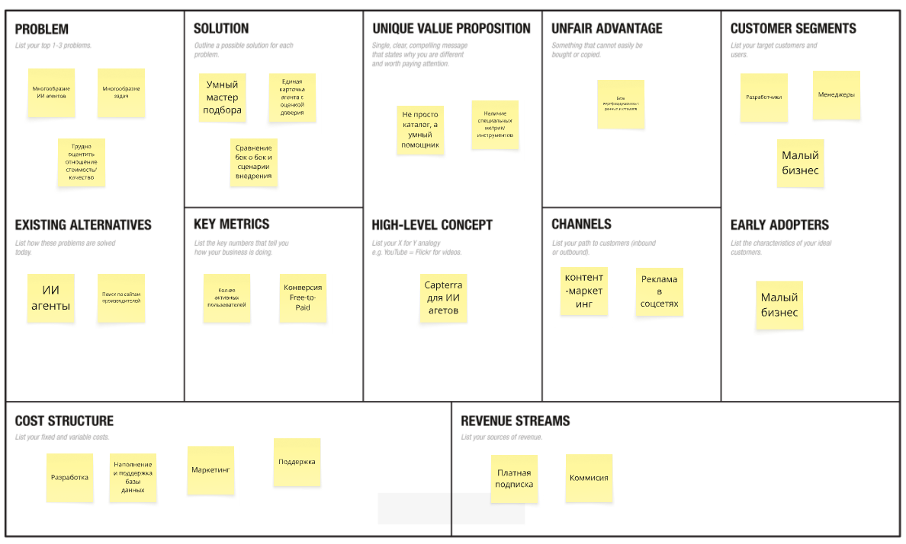
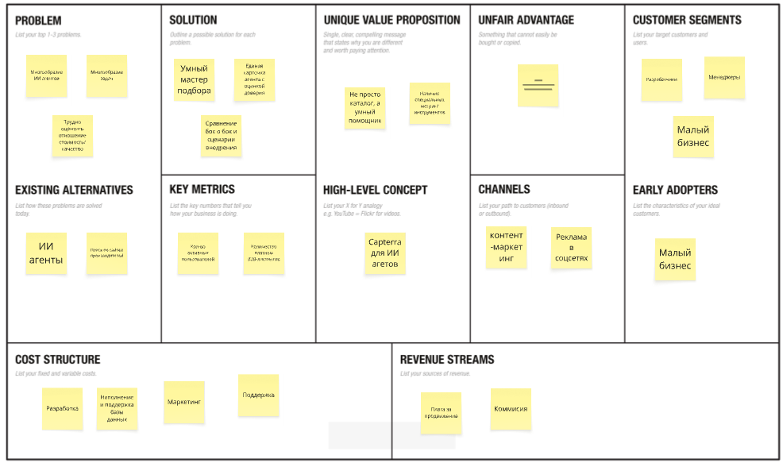

# Задание №1: Проект AgentFind

**Бизнес-модель:** B2C (Business-to-Consumer), B2B (Business-to-Business)

## Elevator Pitch
Рынок ИИ-агентов взорвался: сотни новых решений каждую неделю, но выбрать подходящее — всё равно что гадать на кофейной гуще. Мы строим «Glassdoor для ИИ-агентов» — независимую платформу, которая подбирает стек агентов под вашу задачу, бюджет и инструменты за 5 вопросов и 1 минуту. Никакого маркетингового шума: только персонализированные рекомендации с оценкой уверенности, проверенные интеграции и прозрачное ценообразование. Мы экономим командам десятки часов на исследования и снижаем риск выбрать не того агента

## Lean Canvas

---

# Задание №2

## 1. HADI-гипотезы

### Гипотеза №1 — удобство ИИ-чата

Самый важный риск на старте: проще использовать одного агента для всех задач.

(H) Мы верим, что пользователи готовы использовать стек из нескольких разных ИИ-агентов под конкретные задачи (один для поддержки, другой для маркетинга, третий для кода), а не искать одного универсального. (A) Мы сделаем лендинг с тремя готовыми "ИИ-стеками" под разные профессии и запустим рекламу в профильных Telegram-каналах на 10 000 рублей. (D) Мы замерим конверсию в клики по карточкам внутри одного стека и процент пользователей, которые добавили в избранное 2 и более агента. (I) Если мы получим более 25% пользователей, взаимодействующих с несколькими агентами, гипотеза подтверждена. Если менее 10% — отказываемся от идеи "стеков" и фокусируемся на поиске одного универсального агента

### Гипотеза №2 — платная подписка

Второй риск: бесплатным приложением могут пользоваться, но покупать Pro не захотят.

(H) Мы верим, что пользователи готовы платить за подписку Pro, если бесплатная версия дает базовый поиск, но скрывает самую ценную аналитику (детальный разбор Trust Score, историю надежности агента и экспорт сравнений в PDF), которая экономит их время при выборе. (A) Мы внедрим "мягкий пейволл" (размытие экрана) на расширенные данные в карточках и запустим баннер с предложением 7-дневного бесплатного пробного периода Pro. (D) Мы замерим конверсию из бесплатного пробного периода в платную подписку и общий процент переходов с бесплатной версии на Pro. (I) Если мы получим конверсию из триала в оплату выше 5%, а общий переход в Pro превысит 2% от активных пользователей, гипотеза подтверждена — мы масштабируем B2C-подписку. Если конверсия будет ниже 1%, мы отказываемся от платной подписки для пользователей и полностью переключаем модель монетизации на B2B

**Воронка привлечения и расчет CAC (Customer Acquisition Cost):**
*   Стоимость клика в рекламе (CPC): 10 руб
*   Конверсия в регистрацию: 20%. Стоимость одной бесплатной регистрации: 20 руб / 0,2 = 100 руб
*   Конверсия в покупку платной подписки: 2%
*   CAC = 100 руб / 0,02 = 5 000 руб
  Один платящий клиент обходится в 5 000 рублей

**Расчет LTV (Lifetime Value):**
*   Стоимость подписки: 500 руб/мес
*   Себестоимость обслуживания: 10 руб/мес
*   Чистая прибыль с одного клиента: 490 руб/мес
*   Предположим, средний срок жизни клиента в приложении: 6 месяцев
*   LTV = 490 руб × 6 месяцев = 2940 руб

*   LTV / CAC: 2940 руб / 5 000 руб = 0.588
*   Показатель меньше 1 не соответствует стандарту (LTV > 3*CAC), значит Юнит-экономика не сходится

## 3. Pivot

Один из вариантов дальнейшего развития — AgentFind. Это переход от модели с платной подпиской для обычных пользователей к B2B-сервису по подбору, аудиту и внедрению ИИ-агентов для компаний (Revenue Model Pivot). Модель бесплатного каталога при этом не закрывается: она остается как воронка для привлечения трафика, но мы перестаем пытаться продать пользователям Pro-версию.

Причина такого Pivot в том, что обычные пользователи (фрилансеры, энтузиасты) не готовы платить за расширенные фильтры или детальный Trust Score — им достаточно бесплатной базовой версии. Однако для среднего и крупного бизнеса цена ошибки при выборе ИИ-агента слишком высока. Компании готовы платить за готовые решения, а разработчики агентов готовы платить за доступ к теплым корпоративным лидам.

Elevator Pitch — AgentMatch

Пользователи и бизнес тратят недели на поиск подходящего ИИ-инструмента, увязая в сотнях новых сервисов, а разработчики качественных ИИ-агентов не могут пробиться к своей аудитории из-за высокой стоимости рекламы.

AgentMatch — это интеллектуальный навигатор по миру ИИ-агентов. Вместо долгих поисков пользователь просто описывает свою задачу: выбирает категории задач и мезанизм взаимодействия с ИИ и получает шорт-лист лучших решений, основанный на возможностях ИИ, рейтинге доверия, отзывах и совместимости.

В отличие от обычных каталогов, мы зарабатываем не на подписках самих пользователей, а на двусторонней модели. Пользователи ищут и сравнивают агентов абсолютно бесплатно. Наш доход формируется из двух источников: партнерские комиссии от разработчиков за каждого приведенного клиента, который оформил подписку на их ИИ-сервис (модель CPA), и оплата за продвижение (Featured Listing), когда разработчики платят за приоритетное место в результатах поиска и тематических подборках.

### Предварительная экономика UniFlow Teams

Для сравнения посчитаем те же показатели:

- Подписка на ИИ — **3000 руб./мес.**
- Комиссия — **5%**
- Доход со сделки: `3000 * 0.05 = 150 руб./мес.`
- Средняя продолжительность использования агента — **60 месяцев**.
- Среднее кол-во используемых агентов: 1,8
- Планируемый CAC — **5000 руб.**
- **LTV = 150 × 60 × 2,3 = 16200 руб.**
- **LTV/CAC = 16200 / 5000 = 3,24.**

# Задание №3

## 1. Роли и User Stories

**Роли:**

1. **Владелец малого бизнеса (SMB)** — ищет готовое решение для автоматизации поддержки, продаж или маркетинга без привлечения дорогих разработчиков.
2. **Разработчик / Техлид** — ищет API, MCP-серверы и агентов для интеграции в свои продукты, оценивает техническую надежность.
3. **Продакт-менеджер** — изучает рынок ИИ для внедрения пилотных проектов, сравнивает инструменты по функциям и стоимости.
4. **Разработчик ИИ-агентов** — создатель платформы или сервиса, который хочет привлечь новых клиентов через ваш каталог.

**User Stories:**

1. Как владелец бизнеса, я хочу ответить на несколько простых вопросов о моей задаче, чтобы получить готовый шорт-лист подходящих ИИ-агентов.
2. Как пользователь, я хочу видеть единый рейтинг доверия (Trust Score) на карточке, чтобы не тратить время на неработающие или заброшенные проекты.
3. Как разработчик, я хочу фильтровать агентов по наличию API и документации, чтобы быстро понять, смогу ли я их интегрировать.
4. Как пользователь, я хочу сравнивать до 4 агентов бок о бок по цене и функциям, чтобы принять взвешенное решение.
5. Как продакт-менеджер, я хочу читать верифицированные отзывы от других компаний, чтобы обосновать выбор ИИ-инструмента руководству.
6. Как владелец бизнеса, я хочу видеть, с какими популярными системами интегрируется агент.
7. Как разработчик ИИ-агента, я хочу добавить свой сервис в каталог, чтобы получать целевой трафик.
8. Как разработчик ИИ-агента, я хочу оплатить приоритетное размещение (Featured Listing), чтобы мой сервис показывался первым в поиске.
9. Как пользователь, я хочу сохранять понравившихся агентов в «Избранное» для более позднего изучения.
10. Как пользователь, я хочу видеть прозрачные тарифы (включая скрытые платежи и наличие бесплатного теста).
11. Как пользователь, я хочу видеть краткий гайд «как начать» на карточке агента.
12. Как технический специалист, я хочу фильтровать агентов по базовой ИИ-модели (GPT-4, Claude, Llama), чтобы учитывать требования безопасности компании.
13. Как пользователь, я хочу оставлять отзывы о работе с агентом, чтобы помочь другим сделать выбор.
14. Как разработчик, я хочу видеть аналитику по переходам на мой сайт из вашего каталога, чтобы оценивать эффективность размещения.
15. Как пользователь, я хочу подписаться на дайджест с новыми и лучшими ИИ-агентами по моей отрасли.

---

## 2. Приоритизация функционала (MoSCoW)

**M — Must have (обязательно для MVP):**

- Умный мастер подбора (квиз из 3-5 шагов: задача, бюджет, техническая база).
- Базовые карточки агентов (название, описание, ключевые функции, ссылка на сайт).
- Поисковая выдача (шорт-лист из 3-5 агентов по итогам квиза).
- Возможность ручного поиска по каталогу (строка поиска).
- Трекинг переходов по партнерским ссылкам (для начисления комиссии).

**S — Should have (желательно):**

- Регистрация и вход (для сохранения истории поиска и листингов).
- Система Trust Score (агрегация данных GitHub, документации, отзывов).
- Функция сравнения «бок о бок» (до 4 агентов).
- Фильтры (цена, наличие API, язык).
- Отзывы пользователей с модерацией.
- Личный кабинет для разработчиков (добавление/редактирование карточки агента).

**C — Could have (можно добавить позже):**

- Платные Featured-листинги для разработчиков.
- Функция «Мой ИИ-стек» (сохранение наборов агентов под разные задачи).
- Готовые сценарии внедрения (пошаговые гайды).
- Email-дайджесты и пуш-уведомления о новых агентах.
- Экспорт сравнений в PDF.

**W — Won't have (не делаем):**

- Автоматическое тестирование API агентов прямо на сайте.
- Возможность запускать агентов внутри нашей платформы.

---

## 3. MVP и MLP

### MVP (Minimum Viable Product)

Цель первой версии — проверить, готовы ли пользователи проходить квиз и переходить на сайты агентов, а также заработать первые деньги на партнерских комиссиях.

**Функционал MVP:**

- Простой лендинг с формой умного подбора (задача, сфера бизнеса, бюджет).
- База из 100-200 актуальных ИИ-агентов, занесенных вручную.
- Выдача результатов в виде карточек с кнопкой «Перейти на сайт» (партнерские ссылки).
- Базовая строка поиска.
- Базовый личный кабинет разработчика для самостоятельного добавления бесплатных листингов.

**Сценарий:** Владелец бизнеса заходит на сайт, выбирает «Поддержка клиентов», «До 50$ в месяц», «Без кода». Система выдает 3 агента. Пользователь кликает на лучший и переходит на сайт разработчика, оформляет подписку. Мы получаем комиссию.

### MLP (Minimum Lovable Product)

Цель — сделать сайт основным инструментом выбора для профессионалов, повысить доверие и внедрить платную B2B-модель.

**Что добавим:**

- Внедрение полноценного Trust Score (прозрачный рейтинг надежности).
- Таблица сравнения нескольких агентов по ключевым параметрам.
- Система отзывов и оценок от реальных пользователей.
- Расширенные фильтры (по интеграциям, API, ИИ-моделям).
- Возможность для разработчиков покупать Featured-листинги (платное продвижение).

---

## 4. Детализация требований для MVP

### История 1 — Умный мастер подбора (Guided Wizard)

**User Story:** как владелец бизнеса, я хочу ответить на несколько вопросов о моей задаче, чтобы получить шорт-лист подходящих ИИ-агентов без необходимости разбираться в сложных технических терминах.

**Функциональные требования (ФТ):**

- Пользователь должен иметь возможность начать подбор с главной страницы без обязательной регистрации.
- Мастер подбора должен состоять из 3-5 последовательных шагов (например: 1. Тип задачи, 2. Бюджет, 3. Требования к внедрению).
- Система должна анализировать ответы и сопоставлять их с тегами в базе данных агентов.
- По завершении квиза система должна вывести от 3 до 5 карточек, отсортированных по релевантности.
- Если подходящих агентов нет, система должна вывести ближайшие альтернативы или предложить изменить критерии.
- После получения результатов пользователю должен быть предложен вариант зарегистрироваться для сохранения поиска.

**Нефункциональные требования (НФТ):**

- Время генерации результатов квиза не должно превышать 2 секунд.
- Состояние квиза должно сохраняться при обновлении страницы.

### История 2 — Карточка агента и трекинг переходов

**User Story:** как пользователь, я хочу видеть полную и понятную информацию об агенте и иметь возможность легко перейти на его официальный сайт, чтобы протестировать или купить сервис.

**Функциональные требования (ФТ):**

- Карточка агента должна содержать: название, краткое описание, логотип, цену (или модель монетизации), список ключевых функций.
- В карточке должна быть кнопка «Перейти на сайт».
- При клике на кнопку пользователь должен перенаправляться на внешний URL (с партнерской UTM-меткой или реферальной ссылкой).
- Переход по ссылке должен открываться в новой вкладке браузера, чтобы пользователь не терял ваш каталог.
- Система должна фиксировать факт клика в базе данных (ID агента, дата, время, источник перехода) для внутренней аналитики.

**Нефункциональные требования (НФТ):**

- Обработка клика и редирект на сайт партнера должны занимать менее 0.5 секунды.
- Система должна выдерживать пиковые нагрузки без потери кликов.
- Все внешние ссылки должны открываться по защищенному протоколу HTTPS.
- Данные о кликах должны быть защищены от накрутки (базовая защита от ботов).